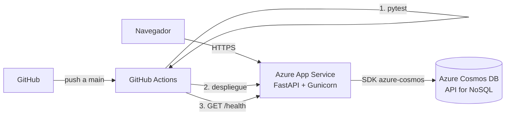

# QA Bitácora

Bitácora de incidencias de calidad (QA) construida con **FastAPI** y **Azure Cosmos DB (API for NoSQL)**, desplegada automáticamente en **Azure App Service** con **GitHub Actions**.

Permite registrar incidencias de distintos proyectos, filtrarlas, comentarlas, moverlas por su ciclo de vida (Abierta → En progreso → Resuelta → Cerrada) y ver un resumen del estado de la calidad.

- **App en línea:** _(se agrega después del primer despliegue)_
- **Video:** _(pendiente)_
- **Artículos:** _(pendiente)_

## ¿Por qué una base de datos NoSQL?

Una incidencia es un documento que crece con el tiempo: se le agregan comentarios, cambios de estado y etiquetas. En una base relacional eso serían tres o cuatro tablas unidas con JOIN; en Cosmos DB es **un solo documento JSON**, que se lee completo en una operación.

| Característica de Cosmos DB | Cómo la usa la app |
|---|---|
| Documentos JSON sin esquema fijo | Cada incidencia guarda sus comentarios, historial y etiquetas dentro del mismo documento |
| Clave de partición `/proyecto` | Las incidencias de un proyecto viven juntas: filtrar por proyecto es una consulta de una sola partición |
| Lectura puntual (id + partición) | Abrir el detalle cuesta ~1 RU, la operación más barata |
| Consultas tipo SQL sobre JSON | `ARRAY_CONTAINS` para etiquetas y `CONTAINS(..., true)` para buscar sin distinguir mayúsculas |
| Patch (actualización parcial) | Agregar un comentario añade un elemento al arreglo sin reescribir el documento |
| Concurrencia optimista con ETag | Si dos personas cambian el estado a la vez, la segunda recibe un aviso en vez de pisar el cambio |

## Arquitectura



```
app/
├── main.py         # Rutas de la API y página web
├── service.py      # Reglas de negocio (ciclo de vida, resumen)
├── repository.py   # Acceso a Cosmos DB y versión en memoria
├── models.py       # Validación de datos (Pydantic)
├── config.py       # Variables de entorno
└── static/         # Interfaz web (HTML, CSS y JavaScript)
tests/              # Pruebas automáticas (pytest)
.github/workflows/  # Pipeline CI/CD
```

## Modelo de datos

Base de datos `bitacora`, contenedor `incidencias`, clave de partición `/proyecto`:

```json
{
  "id": "6f1c...",
  "tipo": "incidencia",
  "proyecto": "tienda-web",
  "titulo": "El total del carrito no suma el envío",
  "descripcion": "Al pagar, el total no incluye el envío.",
  "severidad": "ALTA",
  "estado": "EN_PROGRESO",
  "etiquetas": ["checkout", "calculo"],
  "reportado_por": "Kevin",
  "creado_en": "2026-11-08T22:10:00+00:00",
  "actualizado_en": "2026-11-08T22:30:00+00:00",
  "comentarios": [
    { "id": "a1...", "autor": "Gerald", "texto": "Lo reviso hoy", "fecha": "2026-11-08T22:20:00+00:00" }
  ],
  "historial": [
    { "de": null, "a": "ABIERTA", "autor": "Kevin", "fecha": "2026-11-08T22:10:00+00:00" },
    { "de": "ABIERTA", "a": "EN_PROGRESO", "autor": "Gerald", "fecha": "2026-11-08T22:30:00+00:00" }
  ]
}
```

## API

| Método | Ruta | Descripción |
|---|---|---|
| GET | `/health` | Estado de la app y de la base de datos |
| GET | `/api/incidencias?proyecto=&estado=&severidad=&etiqueta=&q=` | Lista con filtros |
| POST | `/api/incidencias` | Crea una incidencia |
| GET | `/api/incidencias/{proyecto}/{id}` | Detalle (lectura puntual) |
| PATCH | `/api/incidencias/{proyecto}/{id}/estado` | Cambia el estado (valida transiciones) |
| POST | `/api/incidencias/{proyecto}/{id}/comentarios` | Agrega un comentario (Patch) |
| DELETE | `/api/incidencias/{proyecto}/{id}` | Elimina la incidencia |
| GET | `/api/resumen` | Totales por estado, severidad, proyecto y etiquetas |

Documentación interactiva en `/docs`.

## Ejecutar en local

Sin variables de Cosmos DB, la app arranca en **modo demo**: guarda en memoria y carga tres incidencias de ejemplo.

```powershell
python -m venv .venv
.\.venv\Scripts\Activate.ps1
pip install -r requirements-dev.txt
pytest
uvicorn app.main:app --reload
```

Abre http://localhost:8000. Para usar Cosmos DB en local, define `COSMOS_ENDPOINT` y `COSMOS_KEY` (ver `.env.example`).

## Despliegue automático

Cada push a `main` ejecuta el workflow `.github/workflows/ci-cd.yml`:

1. **Pruebas:** instala dependencias y corre `pytest`. Si alguna falla, no se despliega.
2. **Despliegue:** empaqueta la app y la publica en Azure App Service.
3. **Verificación:** llama a `/health` hasta que la app responde.

Configuración necesaria en GitHub (Settings → Secrets and variables → Actions):

| Tipo | Nombre | Valor |
|---|---|---|
| Variable | `AZURE_WEBAPP_NAME` | Nombre de la Web App en Azure |
| Secret | `AZURE_WEBAPP_PUBLISH_PROFILE` | Contenido del perfil de publicación descargado de Azure |

Configuración de la Web App en Azure (Linux, Python 3.12):

- Variables de entorno: `COSMOS_ENDPOINT`, `COSMOS_KEY`, `SCM_DO_BUILD_DURING_DEPLOYMENT=true`
- Comando de inicio: `gunicorn -w 2 -k uvicorn.workers.UvicornWorker --timeout 60 --bind 0.0.0.0:8000 app.main:app`

## Equipo

- Gerald Zevallos Pinto
- Kevin Elvis Hinojosa

Licencia MIT.
